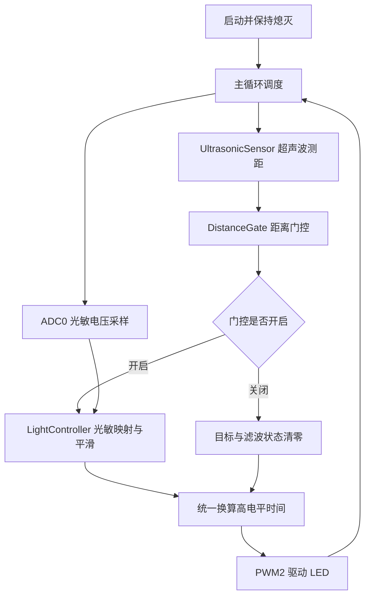

# 智能感应灯

基于 QuecPython 的超声波感应与光敏调光项目。超声波决定“是否允许亮灯”，光敏传感器决定“亮多少”，最终由 PWM2 统一驱动 LED。

当前规则：**有效距离在 100 cm 内时，根据 ADC0 电压平滑调光；检测到距离超过 100 cm 时直接熄灭。ADC 电压越高，目标亮度越高。**

适合用于传感器融合、GPIO 测距、ADC 采样和 PWM 调光的实践教学与功能演示。本项目使用“线性映射 + 一阶滤波 + 变化速率限制”，不是光照闭环 PID，也不将 ADC 电压直接当作 lux 照度。

## 项目亮点

- **双传感器分工明确**：超声波只负责距离门控，光敏负责亮度计算，避免两套逻辑分别写 PWM、互相覆盖。
- **渐亮与快速关灯分开处理**：范围内亮度平滑变化；一旦检测到有效远距离，绕过滤波直接关灯。
- **响应速度可调**：通过 `SENSITIVITY` 同时调整滤波强度和亮度变化上限，兼顾稳定性与响应速度。
- **异常状态有保护**：启动默认熄灭；短暂测距失败保持原门控状态，连续失败达到阈值后关灯。
- **重新进入柔和恢复**：关灯时清空滤波状态，重新进入范围后从零亮度逐步恢复。
- **参数集中、框架轻量**：传感器、门控和调光职责分离，采用单循环调度，无需联网或云端服务。
- **运行状态可观察**：每秒输出 ADC、电压映射目标、平滑亮度、PWM、距离和门控状态。

## 功能规则

| 场景 | 控制行为 |
| --- | --- |
| 启动后尚未取得有效近距离 | 保持熄灭 |
| 有效距离为 2～100 cm，包含 100 cm | 开启光敏调光 |
| 有效距离大于 100 cm，且不超过 800 cm | 当前控制轮次直接关灯，不等待渐变 |
| 连续 1～2 次测距失败 | 保持上一次门控状态 |
| 连续 3 次测距失败 | 关闭门控并熄灭 |
| 取得有效距离 | 清零连续失败计数，并按距离重新判断门控 |
| 重新进入 100 cm 内 | 从零亮度平滑恢复到光敏目标 |
| ADC 读取失败 | 门控开启时保持原亮度；门控关闭时仍强制熄灭 |

软件接受的有效测距范围为 2～800 cm；小于 2 cm、大于 800 cm、超时或异常读数均视为测距失败。该范围沿用所提供的测距脚本，不代表传感器实际保证的量程或精度。

“直接关灯”指**本轮检测到有效远距离后立即执行**，不代表连续、无延迟检测。测距间隔约为 200 ms，再加上测量耗时和循环调度时间。

## 软件框架



### 模块职责

| 模块 | 主要方法 | 职责 |
| --- | --- | --- |
| `UltrasonicSensor` | `read_cm()` | 触发超声波，读取回波脉宽，换算距离并处理超时 |
| `DistanceGate` | `update()` | 判断是否允许亮灯，管理连续测距失败次数 |
| `LightController` | `target_from_mv()` | 把 ADC 电压映射为 0～100% 目标亮度 |
| `LightController` | `update()`、`reset()` | 滤波、限速，以及熄灭时重置状态 |
| `run()` | 主循环 | 协调采样、门控、调光、PWM 输出和状态日志 |

上述模块均位于 [_main.py](_main.py)，不是分别运行的多个程序。超声波不会直接控制 PWM，最终输出由 `run()` 统一处理。

### 一轮控制流程

1. 休眠约 100 ms，按约 200 ms 的测距间隔决定是否进行新一次测距。
2. 将测距结果交给 `DistanceGate`，更新门控状态和失败计数。
3. 读取 ADC0，得到光敏传感器模拟输出的毫伏值。
4. 门控开启时更新光敏亮度；门控关闭时将亮度和滤波状态清零。
5. 根据低电平点亮极性，把亮度转换为 PWM 高电平时间。
6. 仅在高电平时间变化时更新 PWM，约每秒输出一次状态日志。

超声波使用同步 GPIO 轮询，会短暂占用主循环；该实现不是异步、无阻塞测距。

## 调光原理

### 光敏电压映射

当前配置为 `DARK_MV = 360`、`BRIGHT_MV = 180`：

| ADC0 电压 | 目标亮度 | 稳定后高电平时间 | LED 点亮时间占比 |
| --- | --- | --- | --- |
| 180 mV | 0% | 20 ms | 0%，熄灭 |
| 270 mV | 50% | 10 ms | 50% |
| 360 mV | 100% | 0 ms | 100%，最亮 |

该表仅适用于门控开启且亮度已稳定的情况。门控关闭时，无论 ADC 电压是多少，都按熄灭处理。

目标亮度按两个校准端点线性计算，超出校准区间后限制在 0～100%。代码中的 `DARK_MV` 对应请求满亮度的校准端点，`BRIGHT_MV` 对应请求熄灭的校准端点；对调两个值即可反转电压与亮度的关系，两者不能相同。

**当前约定的是“ADC 电压越高，灯越亮”，不能仅凭电压判断环境越亮还是越暗。** 光照与电压的实际方向取决于光敏电路，应通过实测校准。

### 平滑与灵敏度

亮度先经过一阶滤波，再限制每秒允许变化的最大幅度，最后才换算成 PWM 参数。

| `SENSITIVITY` | 滤波时间常数 | 每秒最大内部亮度变化 | 效果 |
| --- | --- | --- | --- |
| 1 | 2.5 s | 5 个百分点 | 响应慢、过渡柔和 |
| 5 | 约 1.442 s | 约 38.33 个百分点 | 默认折中设置 |
| 10 | 0.12 s | 80 个百分点 | 响应较快 |

中间档位线性插值。滤波可能让实际过渡比变化上限更慢，尤其在接近目标时。主循环计算亮度变化时，会把单次有效时间间隔限制在最多两个采样周期，避免调度延迟后出现过大的亮度跳变。

### PWM 与低电平点亮

当前采用 `misc.PWM`、`PWM.PWM2`、`PWM.ABOVE_MS`，周期为 20 ms，对应频率 50 Hz。

```python
pwm = PWM(PWM.PWM2, PWM.ABOVE_MS, high_time, 20)
pwm.open()
pwm.open(PWM.ABOVE_MS, high_time, 20)
```

由于 LED 低电平点亮，高电平时间约等于 `(100 - 亮度百分比) × 20 / 100`，再四舍五入为整数毫秒。

- `high=0ms`：整个周期为低电平，最亮。
- `high=10ms`：低电平占一半周期。
- `high=20ms`：整个周期为高电平，熄灭。

20 ms 周期下有 0～20 ms 共 21 个高电平时间档位，占空比每档变化 5%。内部亮度可以连续变化，硬件输出仍有分档；降低灵敏度只会延长换档时间，不会增加 PWM 档位。点亮时间占比也不等同于人眼感受到的线性亮度。

## 硬件接线

| 外设信号 | 模组接口 | 说明 |
| --- | --- | --- |
| 光敏传感器 AO | ADC0 | 使用模拟输出，不是数字开关输出 DO |
| 超声波 TRIG | `Pin.GPIO13` | 输出触发脉冲 |
| 超声波 ECHO | `Pin.GPIO12` | 输入回波信号 |
| LED 控制信号 | PWM2 | 当前电路为低电平点亮 |
| 各外设 GND | 模组 GND | 必须共地 |

注意：

- GPIO 枚举不等于开发板排针号，须根据实际模组和开发板确认 ADC0、GPIO13、GPIO12、PWM2 的物理引脚及复用关系。
- 传感器电源按其硬件规格连接。ADC 和 GPIO 并非普遍支持 3.3 V 或 5 V 输入，必要时使用分压或电平转换。
- 若 ECHO 为 5 V，不能直接接到不耐受该电压的 GPIO。
- 大功率灯具应使用合适的限流与驱动电路，不能直接由 PWM 引脚供电。
- 光敏传感器应尽量避免直接受到受控 LED 照射，以免引入未设计的光学反馈。

## 参数配置

参数集中在 [_main.py](_main.py) 开头：

| 参数 | 默认值 | 含义 |
| --- | --- | --- |
| `DARK_MV` | `360` | 请求 100% 亮度的 ADC 校准端点，单位 mV |
| `BRIGHT_MV` | `180` | 请求 0% 亮度的 ADC 校准端点，单位 mV |
| `SENSITIVITY` | `5` | 灵敏度，范围 1～10 |
| `PWM_CYCLE_MS` | `20` | PWM 周期，单位 ms，必须为正整数 |
| `SAMPLE_MS` | `100` | 主循环休眠时间，单位 ms |
| `INITIAL_BRIGHTNESS` | `0.0` | 控制器初始亮度；启动门控会将其重置为零 |
| `LED_ACTIVE_HIGH` | `False` | 当前 LED 为低电平点亮 |
| `DISTANCE_LIMIT_CM` | `100.0` | 允许光敏调光的最大距离，包含该边界 |
| `DISTANCE_SAMPLE_MS` | `200` | 两次测距之间的最小等待时间，单位 ms |
| `DISTANCE_FAILURE_LIMIT` | `3` | 连续无效测距达到此次数后关灯 |

例如，把 `DISTANCE_LIMIT_CM` 改为 `80.0`，即可改成 80 cm 内允许光敏调光。改变 PWM 周期前，应先确认模组支持的时间范围、频率和占空比端点。

## 文件结构

```text
智能灯/
├── _main.py          # 智能灯主程序，已集成超声波、光敏和 PWM
├── __init__.py       # 包入口
├── sr04-gpio.py      # 原始独立超声波测距参考脚本
└── README.md         # 项目说明
```

[sr04-gpio.py](sr04-gpio.py) 保留了原始独立测距实现。主程序不导入该脚本，也不需要它才能运行；不要与主程序同时执行，以免两个程序操作同一组超声波引脚。主程序已改用官方 `Pin.write()` / `Pin.read()` 接口，并使用实际微秒计时，而不是用循环次数估计超时。

## 部署运行

1. 准备支持所用 ADC、GPIO、PWM 接口的 QuecPython 模组及匹配固件，完成接线和电压检查。
2. 把 [_main.py](_main.py) 与 [__init__.py](__init__.py) 上传到设备的 `/usr/` 目录。
3. 停止其他占用 PWM2、GPIO13、GPIO12 的程序，再在设备 REPL 中运行：

```python
import example
example.exec('/usr/_main.py')
```

本项目使用模组内置的 `misc`、`machine` 和 `utime`，不需要安装第三方 Python 包。它不是可以直接在普通电脑 Python 环境运行的硬件程序。

启动后灯保持熄灭；取得有效近距离后，由光敏电压决定亮度。调整光敏输入、移近或移远被测物体即可观察状态变化。

## 运行日志

主程序约每秒输出一条状态，以下是门控开启、亮度接近稳定时的示例：

```text
ADC0=307mV target=70.6% brightness=70.6% PWM=30.0% high=6ms distance=50.0cm enabled=True
```

| 字段 | 含义 |
| --- | --- |
| `ADC0` | 当前 ADC0 电压，单位 mV |
| `target` | 当前目标亮度；门控关闭时强制为 0% |
| `brightness` | 滤波和限速之后的内部亮度 |
| `PWM` | 实际高电平占空比，不是 LED 亮度百分比 |
| `high` | 一个 PWM 周期内的高电平时间 |
| `distance` | 最近一次测距结果，单位 cm |
| `enabled` | 是否允许按光敏电压调光 |

无效测量显示为 `--`。`enabled=True` 仅代表门控允许调光，不保证灯一定亮：光敏仍可能请求 0% 亮度。测距短暂失败时，距离可以显示 `--`，而门控暂时保持此前状态。

低电平点亮时，示例中的 `PWM=30%` 表示约 70% 的点亮时间；在 20 ms 周期下，`high=6ms`。不要把高电平占空比直接理解为 LED 亮度。

## 边界与限制

- **边界抖动**：当前直接用单次有效距离判断，没有距离平均滤波或进出滞回。物体在 100 cm 附近、读数来回跳动时，门控可能反复切换。
- **测距精度**：回波脉宽通过 GPIO 轮询测量，受解释器和调度影响。使用 `duration_us / 58.0` 换算厘米；准确性需要实测，不能据软件范围宣称具备 8 m 测距能力。
- **超时限制**：等待回波上升沿最多约 30 ms，等待脉冲结束最多约 50 ms；通过 `ticks_diff()` 处理计时器回绕。
- **频率与分辨率权衡**：20 ms 周期提高了毫秒模式的占空比档位数，但频率只有 50 Hz，可能出现可见或相机拍摄闪烁。
- **平台差异**：必须确认模组支持 20 ms 周期、PWM2，以及零高电平和整周期高电平。官方文档中，EC200U/EC600U/EG915U/EG912U 的 `ABOVE_MS` 范围为 `(0,10]`，不能直接套用本项目端点与周期；FCM360W 也有不同限制。
- **退出状态**：初始化或更新 PWM 失败会抛出异常。退出主循环时会尝试关闭 PWM 和 ADC，但 `PWM.close()` 后引脚电平取决于固件，不能据此保证灯一定熄灭。
- **验证范围**：已进行软件模拟检查，覆盖门限、异常关灯、平滑恢复、测距超时和计时回绕；未据此宣称完成硬件整体验证。接线、PWM 极性、测距与调光效果仍需在目标设备上确认。

## 官方接口参考

- [ADC：模拟电压采样](https://python.quectel.com/doc/quecpython/API_reference/zh/peripherals/misc.ADC.html)
- [PWM：脉宽调制输出](https://python.quectel.com/doc/quecpython/API_reference/zh/peripherals/misc.PWM.html)
- [Pin：GPIO 输入输出](https://python.quectel.com/doc/quecpython/API_reference/zh/peripherals/machine.Pin.html)
- [utime：时间与延时](https://python.quectel.com/doc/quecpython/API_reference/zh/stdlib/utime.html)